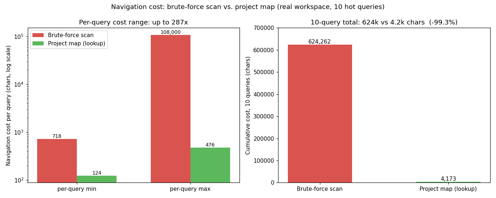

# gov-hub · Project Map for AI Coding Agents

English | [中文](README.md)

  

*DSH plugin · Agent Skill · project map · file / codebase navigation · AI coding agent*

**gov-hub is a DSH plugin and a generic Agent Skill** that gives your AI coding agent a
**project map**. It records "which file holds the authoritative answer" in a plain
`registry.yaml` inside your workspace, so the agent lands on the right document with one
`lookup` command instead of brute-force globbing and grepping through tens of thousands
of files. It navigates **files, not code symbols** — keep using host grep for functions
and classes.

> **Status: 0.3.0** — loose-profile MVP + `ensure` gate + one-command install + three
> distribution formats. Works with DSH (DeepSeek Harness), Claude Code, and any host that
> reads `SKILL.md` / `AGENTS.md`.

## At a glance

| Question | Answer |
|---|---|
| **What is it** | A file navigation map inside your workspace plus a PyYAML-only Python CLI — not chat memory, not a vector store, not a code-symbol index |
| **What it solves** | Every session re-pays discovery cost: token burn on navigation, plus frequent reads of the wrong file |
| **Install** | `pip install pyyaml`, then `python govhub.py install` — one minute, fully reversible with `uninstall` |
| **Use** | `lookup "keyword or full question"` before answering; `add` new authoritative files after answering |
| **Results** | 96.7%–99.3% lower navigation cost over 10 queries, up to ~376× per query; same-question Q&A **141s / 40 calls → 40s / 5 calls** (3.5× faster, 8× fewer calls) |

## Why

Agents don't remember where things live in *your* workspace. Each new session pays the same
discovery cost again — listing folders, running full-text search, reading dead ends — until
it finally reaches the one authoritative document.

gov-hub moves that knowledge out of the model's transient inference and into **ordinary
text files in your workspace**:

- `registry.yaml` — human-readable registry: path, keywords, what it answers, authority level;
- `gov-hub.yaml` — declared scope: the agent stays inside the declared roots, never silently expanding;
- `.govhub/index.json` — rebuildable lookup index (generated, never cited as authority).

No cloud, no embeddings, no telemetry. Copy the repo and the map travels with it.

## Quick start

```bash
# 1. Get it
git clone https://github.com/songzhou666/gov-hub.git
cd gov-hub
pip install pyyaml                          # the only third-party dependency

# 2. One-command install: skill into the discovery root + entry block into AGENTS.md + self-check
python govhub.py install                  # user scope (recommended), all sessions
python govhub.py install --scope project  # or this project only (.dsh/skills/)

# 3. Uninstall (fully reversible; workspace map data is untouched)
python govhub.py uninstall
```

For non-DSH hosts (e.g. Claude Code), pass `--skill-dir` to point at that host's skill
directory, and use `attach --file` for its entry file:

```bash
python govhub.py install --skill-dir <host skill dir>     # e.g. Claude Code: ~/.claude/skills
python govhub.py attach  --root <workspace> --file <workspace>/CLAUDE.md
```

After that it's automatic: ask "where is the login test report?" — the agent runs
`ensure` (should the map be used?), `lookup` (lands on the file), then `add` feeds any
newly found file back into the map. You don't need to remember commands.

## Requirements

- Python ≥ 3.9 (no venv needed)
- PyYAML (`pip install pyyaml`) — every command needs it; there is no fallback path
- No database, no vector store, no network

Try it against the two bundled sample workspaces (loose / mapped profiles):

```bash
python govhub.py check  --root seeds/sample-workspace   # Result: pass ✅ (6 entries)
python govhub.py lookup 账期 --root seeds/sample-workspace
# [  7.0] rule.billing-cycle · canonical · rules/03_账期对账规则.md
```

## How it works: one loop, three commands

| Command | Role |
|---|---|
| `ensure` | Gate: `[OK]` enabled → look up first; `[MUTED]` declined → stay silent; undeclared → welcome text + `[NEXT]` so the agent asks you once |
| `lookup "<keyword or full question>"` | Layered scoring (title / keywords / answers / path; exact match full weight, containment half), ties broken by authority rank → authoritative file path |
| `add <file> --keywords ... --answers "..."` | Backfill: register any file found the hard way, with automatic check + index sync |

Supporting commands: `init` · `check` (registry ↔ disk consistency gate) · `status`
(four health lamps) · `suggest` (proposals from query trails) · `attach` / `detach`
(managed block in `AGENTS.md`, removable without touching surrounding content) ·
`install` / `uninstall`.

**Four health lamps**: supply (registry consistency), execute, output, backfill — each
backed by a mechanical check. `loose` is the zero-assumption, read-only default; the
`mapped` profile scans the latter three only after container mappings are declared.

**Design rule: decisions come from command output, not model judgment.** Whether to enable
and whether to ask are printed by `ensure` rather than left to the model's discretion —
timing decisions left to model judgment were measured to fail
(see [`references/anti-patterns.md`](references/anti-patterns.md)).

## Common commands

```bash
# Initialize (candidate roots need human confirmation before being frozen)
python govhub.py init --root <workspace>

# Register one asset (auto consistency check + index sync)
python govhub.py add docs/login-test-report.md --root <workspace> \
  --keywords login,captcha,test-conclusion --answers "Login captcha test conclusion and evidence"

# Look up
python govhub.py lookup "login captcha conclusion" --root <workspace>

# Consistency check / health report / backfill proposals
python govhub.py check   --root <workspace>
python govhub.py status  --root <workspace>
python govhub.py suggest --root <workspace>

# Write the entry block into AGENTS.md (idempotent; detach removes only that block)
python govhub.py attach --root <workspace> --scope project
python govhub.py detach --root <workspace> --scope project
```

**Registry discipline**: several independent files on the same topic (e.g. one list per
client) → **one entry each**, never a merged "summary table". Never store counts or
statistics in the map — count them live; any number written into the map goes stale.

## Effect data and provenance

**Micro-benchmark**: on a real 36-file / 167-entry asset area, 10 high-frequency keywords
taken from the registry. **Both paths include reading the target file**, so the delta is
purely navigation:

| Metric | Brute force | Project map | Gap |
|---|---|---|---|
| Per query | 9,901–140,949 chars | 276–719 chars | up to ~376× |
| 10 queries (neutral keywords, reproducible via `bench_lookup.py`) | 624,262 chars (≈375k tokens) | 4,173 chars (≈2.5k tokens) | **−99.3%** |
| 10 queries (earlier business keywords, same method) | 110,758 chars (≈66k tokens) | 3,617 chars (≈2.2k tokens) | −96.7% |



**End-to-end (same question, real sessions)**: in a workspace of ~57k files, the same
question went from 141s+ / 40 calls (unfinished) to **40s / 5 calls** after backfilling
3 entries — 3.5× faster, 8× fewer calls. Hit runs stayed at 23–75s / 4–10 calls; brute-force
runs took 93–230s / 15–40 calls, with up to ≈6.8× token difference.

**Caveats** — read these before quoting the numbers:

- The micro-benchmark excludes retries, re-reads caused by wrong hits, and context pollution;
- tokens are estimated as chars×0.6, order-of-magnitude only;
- the end-to-end sample is small (2–4 runs per group), single workspace, single day;
- **installing ≠ instant savings**: day one with an empty registry still brute-forces
  (43 calls measured). Payoff arrives after 2–3 backfill rounds — which is why `add` is the
  core loop.

Full scripts and raw data: [`bench/bench_lookup.py`](bench/bench_lookup.py) ·
[`bench/RESULTS.md`](bench/RESULTS.md) · [`docs/PERFORMANCE.md`](docs/PERFORMANCE.md).

## Scope

**Good for**: workspaces with accumulated docs, rules, reports and test evidence, where the
agent repeatedly answers "where is this conclusion / when was this tested".

**Not for**: writing feature code, semantic code-symbol search (use host grep), questions
about past conversations (the map stores no dialogue), or workspaces without authoritative
documents.

**Yields to existing protocols**: if a project already defines its own lookup tool or
`_registry.yaml`, that protocol wins and this skill stays silent.

## Privacy and boundaries

- **Local only**: no network calls, no uploads, no telemetry;
- **Minimal dependencies**: Python ≥3.9 + PyYAML only; no database, no vector store;
- **Additive only**: apart from the `install` / `attach` / `init` / `add` you run yourself,
  no workspace files are written (declining leaves one intent marker);
- **Fully reversible**: `detach` removes only its own managed block (surrounding content
  untouched); `uninstall` removes the skill;
- Only paths and keywords are indexed — file contents are never copied.

## Distribution

- **DSH native bundle**: root `package.json` declares `dsh.bundle`; installable via
  `install_bundle` with this repo's Git URL, listable by a plugin market;
- **SkillHub skill pack**: root `SKILL.md` carries publish metadata; upload the directory as-is;
- **Plain clone**: no platform required.

## Repository layout

```
gov-hub/
├── SKILL.md                 # skill body (publish metadata + operating manual)
├── govhub.py                # CLI entry (wraps src/govhub)
├── src/govhub/              # implementation (cli.py / core.py)
├── lib/index.js             # DSH bundle provider (zero-dependency ESM)
├── package.json             # dsh.bundle declaration
├── docs/                    # DESIGN / PERFORMANCE / UX copy / sensitivity checklist / charts
├── bench/                   # navigation-cost benchmark and raw results
├── references/              # progressive disclosure: anti-patterns / examples / deep FAQ
└── seeds/                   # two runnable fictional sample workspaces
```

## FAQ

1. **Why doesn't it always trigger after install?** Skill routing matches on `description`
   probabilistically. The deterministic entry point is the managed block `attach` writes
   into `AGENTS.md` — run it once after enabling.
2. **What if `lookup` misses?** Say so honestly, fall back to normal search, then `add`
   the authoritative file immediately so the next query hits (`suggest` surfaces frequent
   misses as proposals).
3. **Does the map survive a new machine?** Yes. Map data lives in the workspace and travels
   with the repo; re-run `install` for the skill itself.
4. **Does it slow down projects that don't use it?** No. Undeclared areas return `[NEXT]`
   from `ensure` (one command); declined areas return `[MUTED]` and stay silent.
5. **Why "gov-hub"?** Short for governance hub — a shared convention for "which file is
   authoritative" in an agent workspace. User-facing copy always says "project map".

More: [`references/faq-deep.md`](references/faq-deep.md) ·
[`references/examples.md`](references/examples.md) ·
[`docs/UX_COPY.md`](docs/UX_COPY.md) · [`docs/DESIGN.md`](docs/DESIGN.md)

## Keywords

DSH plugin · Agent Skill · project map · file / codebase navigation · AI coding agent ·
Claude Code skill · token savings · authoritative file · lookup

## Maintainer

songzhou

## License

[MIT](LICENSE)
