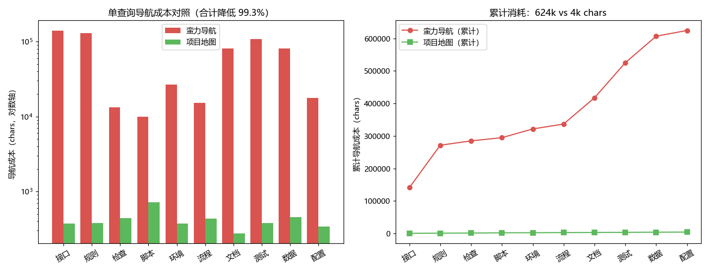

# gov-hub

> Agent 工作台的**治理骨架**：知识供给 → 执行 → 产出 → 回灌，四段链路可感知、可审计、可自启。
>
> **状态：0.2.0（loose 档 + ensure 入口 + 一键安装）**

**为什么用它**：真实项目实测，AI 找文件的导航成本**降低 96.7%~99.3%**
（10 个高频查询，蛮力 62.4 万 chars vs 地图 4.2 千 chars，含读目标文件的保守口径）
——数据与图表见 [docs/PERFORMANCE.md](docs/PERFORMANCE.md)。

**端到端也验证过**：真实 dogfood 会话里，同一类问题走地图命中后
**23~75 秒答完（4~10 次调用）**；不走地图蛮力翻要 **3 分多钟、最多 40 次调用**，
tokens 相差最高 **≈6.8 倍**。同题三代对照（无地图 → 启用回灌 → 命中直达：
141s+/40 次调用 → **40s/5 次调用**）证明"第一问喂地图，第二问省钱"——
完整数据见 [bench/RESULTS.md](bench/RESULTS.md)。



## 快速上手（MVP）

```bash
# 1. 获取（任选其一）
git clone https://github.com/songzhou666/gov-hub.git   # 或下载 zip 解压到任意目录

# 2. 一键安装：SKILL.md 进技能发现根 + 入口块进 AGENTS.md + 自检
python govhub.py install                   # 用户级（推荐），所有会话生效
python govhub.py install --scope project   # 或仅本项目

# 3. 卸载（完全可逆，工作区数据文件不受影响）
python govhub.py uninstall
```

装完即全自动：会话里问"XX 在哪个文件 / 结论在哪"，agent 自动
`ensure → lookup → 直达权威文件`，答完顺手把新读到的权威文件 `add` 回地图。

日常命令（工作区内）：

```bash
python govhub.py init   --root <工作区>   # 范围确认关 + 登记表骨架生成
python govhub.py add    <文件> --root <工作区> --keywords 词1,词2 --answers "能回答什么"  # 登记一条（自动机检+同步索引）
python govhub.py check  --root <工作区>   # 机检：登记表 ↔ 磁盘一致；通过则同步检索索引
python govhub.py lookup 账期 --root <工作区>  # 关键词或整句问法 → 资产单元 → 权威文件
python govhub.py status --root <工作区>   # 四段健康灯 + 回灌缺口
python govhub.py suggest --root <工作区>  # 从路线迹提炼：该补的关键词 / 该建的条目
python govhub.py attach --root <工作区> [--scope project|user]  # 入口块写进 AGENTS.md（可 detach 撤销）
python govhub.py detach --root <工作区> [--scope project|user]  # 精确移除入口块，块外内容不动
```

**让每个会话都先走地图**：`attach` 会在 `AGENTS.md` 里写一段带标记的入口
（`<!-- gov-hub:begin -->` … `<!-- gov-hub:end -->`）——块外一个字节不动、重复执行不重复追加、
`detach` 可逐字节还原。`--scope user` 写进用户级 `$DSH_HOME/AGENTS.md`，一次注册全部项目生效，
块内带条件句，未启用 gov-hub 的项目自动忽略。**建议先问用户是否要写，再执行。**

冷启动 3 分钟剧本：`init`（选范围，骨架自动生成）→ 把两条示例条目改成真实资产 →
`check`（全绿 + 索引同步）→ `status`（四灯亮起）。映射产物 `.govhub/index.json`
携带 scope 指纹，范围或登记表变更后自动重建——索引永远可重建、永不作权威引用。

可运行的完整示例见 [`seeds/sample-workspace/`](seeds/sample-workspace)（loose 档，虚构业务域）
与 [`seeds/sample-workspace-mapped/`](seeds/sample-workspace-mapped)（mapped 档，含 1 条演示缺口）。

| 能力 | loose 档 | mapped / convention 档 |
|---|---|---|
| 范围声明 + 指纹 | ✅ | ✅ |
| 登记表 + check 机检 | ✅ | ✅ |
| lookup 检索（分层打分 + 权威级排序） | ✅ | ✅ |
| 执行/产出/回灌灯 + 缺口扫描 | 提示未启用 | ✅ |

## 维护者

songzhou

## 安装（DSH 用户级 skill 薄壳）

把 `dsh/SKILL.md` 拷到你的 DSH 用户级 skills 目录：

```bash
# Windows（DSH_HOME 默认 ~/.dsh；若设置了 DSH_HOME 环境变量则用它的 skills 子目录）
mkdir -p "$env:DSH_HOME\skills\gov-hub"   # 默认即 $env:USERPROFILE\.dsh\skills\gov-hub
copy dsh\SKILL.md "$env:DSH_HOME\skills\gov-hub\SKILL.md"
```

新会话的 skill 目录出现 `gov-hub` 即装好；卸载 = 删这一个文件。
注意：CLI 本体（本仓库）路径会被 SKILL.md 正文引用，请保持仓库在固定位置，
或按你实际的克隆路径修改 SKILL.md 中的命令路径。

## 用户体验口径

所有面向用户的文案（CLI 提示、确认关、将来插件 description）以
[`docs/UX_COPY.md`](docs/UX_COPY.md) 为唯一权威：好处先行、用户词汇
（"项目记忆表"而非"治理"）、三条硬边界与退出成本必须随文案出现。
授权生命周期：展示意图 → 启用 / 暂不启用（永久静默）/ 先不用（下次轻量追问）→
全程最多打扰用户两次。

## 这是什么

gov-hub 不是效率工具，也不是插件市场。它解决一个具体问题：
当 Agent 在一个工作区里长期工作时，如何让**知识资产的积累形成良性循环**，并且让循环的健康度**可被看见、被机检兜底**。

三个核心机制：

1. **范围声明协议（Scope Protocol）** —— 治理边界永远是"声明的"，不是"推断的"。
   范围判定错误是治理系统的头号灾难源，因此：启发式探测只产生候选，人工确认后才固化；
   所有扫描产物标为 generated，scope 指纹失配即自动失效；越界引用走待决队列，绝不静默扩界。
2. **布局适配层（Layout Profiles）** —— 治理逻辑活在登记表（逻辑层）之上，不依赖目录命名（物理层）。
   默认 `loose` 档零假设只读治理；`mapped` 档声明容器映射；`convention` 档仅对新产出施加命名规范。
   改名永远是"提案 + 批准 + 修引用"，绝不自动执行。
3. **四段健康灯 + 回灌缺口（Governance Loop）** —— 供给/执行/产出/回灌各绑定机检；
   回灌缺口采用增量口径（只盯新增，不追溯存量），让飞轮第一天就能转出正反馈。

## 出处分明

本插件的方法论源自一个**生产环境的软件测试工作台**的长期实践：
机读资产登记表、单向 SSOT→薄壳规则加载、机检巡检闸门、回灌纪律，
均在该工作台日常运转中被验证。为保护源工作台的隐私，此处不提供任何可识别信息；
出处是**理念级**的，不是地址级的。

## 硬边界（开发者必读）

- 本仓库**永远不引用**源工作台的任何路径、配置或业务内容；
- 源工作台侧也**不落任何**本插件的开发产物——两侧物理隔离，各自独立机检；
- 凡从源实践提炼的内容，必须经 `docs/sensitivity-checklist.md` 核对后才可入库；
- 通用层代码**重写**而非搬运——隐性假设比显式代码更危险。

## 目录结构（规划）

```
gov-hub/
├── docs/
│   ├── DESIGN.md                  # 架构设计（scope 协议 / 布局适配层 / 回灌巡检）
│   ├── SENSITIVITY_CHECKLIST.md   # 发布前脱敏核对清单
│   └── COLD_START.md              # 冷启动坡道设计（种子语料 / 第一天全绿剧本）
├── seeds/                         # 虚构示例工作区（冷启动夹具，含故意命乱的目录）
└── src/                           # 通用层实现（0.1.0 前不编码）
```

## License

MIT
