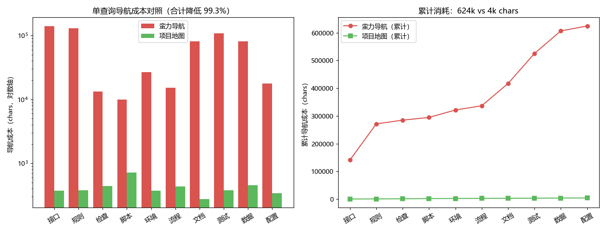

# 性能实测：项目地图 vs 蛮力导航

> 数据来源：[bench/bench_lookup.py](../bench/bench_lookup.py) 在真实项目资产区
> （36 个 md 文件、167 条登记表）上的自动化对照实验，可换任意工作区复现。
> 本文结论引用于用户文案（见 [UX_COPY.md](UX_COPY.md)）。

## 结论速览

| 指标 | 蛮力导航 | 项目地图 | 差距 |
|---|---|---|---|
| 单查询导航成本 | 9,901 ~ 140,949 chars | 276 ~ 719 chars | 最高 **约 376 倍** |
| 10 查询累计（中性高频词） | 624,262 chars ≈ 37.5 万 tokens | 4,173 chars ≈ 2,500 tokens | **降低 99.3%** |
| 另一组 10 查询（早期业务词） | 110,758 chars ≈ 6.6 万 tokens | 3,617 chars ≈ 2,200 tokens | 降低 96.7% |

**综合区间：导航成本降低 96.7%~99.3%，token 节省同比例。**
查询词越泛化（如"测试""数据"），蛮力路径膨胀越快（全文检索命中 20~29 个文件），
地图路径几乎不变——**查询越宽泛，地图优势越大**，这恰好是真实使用的常态。

## 实验口径（为什么数字可信）

两条路径**都包含"最终打开目标权威文件"的成本**，因此差值纯粹是"找到该读哪个
文件"的导航成本。蛮力路径 = 目录浏览 + 全文检索命中行 + 按文件名误读候选（≤2 个）
+ 读目标文件；地图路径 = lookup 前 3 条命中 + 读同一目标文件。

保守性说明：
- 蛮力路径**未计**试错重试、误读后的重新定位、上下文污染导致的返工——真实场景这些成本远高于首次检索；
- token 按 chars×0.6 粗估，仅取量级；
- 实验只读被测资产区，脚本与结果（脱敏后）均在本仓库，可独立复核。

## 图表解读

- **左图（对数轴柱状）**：每个查询词的单次导航成本。红柱（蛮力）跨 3 个数量级
  （~700 到 ~140,000），绿柱（地图）全部贴地（<500）——差距是数量级的，不是百分比的。
- **右图（累计折线）**：连续干活 10 个任务的累计消耗。红线加速上升（任务越多，
  蛮力浪费越大），绿线几乎水平——**项目地图的价值随使用深度放大**。
